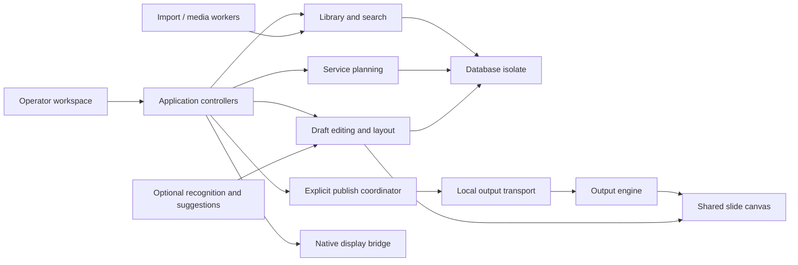

# Cantivra desktop architecture

Design baseline: 4 November 2026. This document describes the intended product and the initial Phase 1 boundary. Version 0.2 adds the separate-process design in [PHASE2_PLAN.md](PHASE2_PLAN.md); its historical results are in [PHASE2_VERIFICATION.md](PHASE2_VERIFICATION.md). Version 0.3 adds reviewed content structure, measured typography, incremental draft layout, schema 2 and draft recovery as specified in [PHASE3_PLAN.md](PHASE3_PLAN.md). A design decision or a table listed under “future” is not a claim that the corresponding feature works today. Release evidence belongs in [QA.md](QA.md).

## Phase 2/3 startup and shutdown closure — version 0.3.3

`OperatorBootstrap` owns the operator startup lifecycle. It resolves the exact local workspace and attaches a repository-independent `DesktopOutput` before opening SQLite. If storage cannot open, `OperatorStartupApp` exposes the captured output and explicit emergency/black/restore controls. Startup, retry and reconnect inspect only the existing renderer: they cannot launch a replacement, alter display placement or publish a frame. Corrupt/future databases are retained for investigation. Retry reuses the transport and transfers its newest acknowledged frame into the workspace after in-flight emergency actions drain.

Invalid optional theme data reports a warning and uses the preview default without rewriting the saved setting. Fundamental content-load failure still permits independent renderer inspection. These paths preserve the distinction between a storage problem, a draft and the congregation's accepted frame.

The draft save queue selects the latest snapshot when each operation starts and drains corrections received during writes before navigation proceeds. Explicit Quit saves current edits, requests renderer shutdown, then drains any corrections entered while shutdown was awaiting acknowledgement. Failed validation or saving keeps the operator open. Native Quit requests use the actual macOS AppDelegate or Windows `WM_CLOSE` save gate; a presentation process cannot request operator Quit. Windows execution remains an external verification requirement.

The macOS gate cancels the initial termination attempt while Dart prepares the close, then permits one new termination attempt after explicit approval. The handshake is scheduled through Cocoa's run loop. This avoids holding Flutter's merged platform/UI work inside AppKit's pending-termination loop. Repeated requests during a pending save are refused, and a missing or failed handler never approves closure. OS shutdown/logout interaction remains part of manual platform acceptance.

## Repository and environment assessment

The workspace was empty at the start of this project: there was no application, dependency manifest, database, platform runner, or existing user data to migrate. The available development host runs macOS 26.5.2 and provides Flutter, Dart, Xcode and Clang. Windows execution and physical HDMI distribution hardware are separate validation requirements.

This is a native Flutter desktop application with macOS and Windows runners. Essential operation uses local files, local SQLite and native windows. There is no web runtime, account requirement, hosted database, subscription dependency or service required for presentation.

## Primary product invariants

1. Selecting, searching, editing, importing, changing a draft theme and opening another section never publish content.
2. Only an explicit presentation command can replace a live snapshot. A published slide contains its own text and style values; it cannot change because an editor object changes.
3. Renderer failure to prepare a replacement preserves its last accepted slide. Search, database and import errors are reported to the operator without replacing the output with an error screen.
4. Opening an output begins on black. Reconnecting a display does not automatically broadcast a draft or restore an unreviewed crash recovery item.
5. Emergency black takes precedence over normal navigation and freeze. Clearing text keeps its background; black hides both. Restoring content is explicit.
6. The operator must be able to distinguish the selected draft, last submitted snapshot, and confirmed renderer state. A failed delivery must never be reported as a successful visible change.
7. Local content survives restart. Destructive actions require confirmation, and migrations never silently reset an unreadable database.
8. The output window contains only the presentation. Operator controls, file dialogs, notifications and error detail belong to the operator window.

## Stack and scope of platform support

| Concern | Decision | Reason and boundary |
| --- | --- | --- |
| Desktop shell and rendering | Flutter/Dart, stable SDK | Native Windows/macOS binaries, consistent text layout and reusable presentation canvas. |
| Persistence | SQLite through `sqlite3` FFI | Local transactional storage, FTS5, no server. A long-lived database isolate owns the connection. |
| Full-text search | SQLite FTS5 plus bounded application ranking | Title/body prefix and phrase search first; typo candidates and local-use ranking can be added without altering live state. |
| Output window | Separate native renderer process behind `OutputTransport` | Same executable with an output role, renderer-owned loopback endpoint, private authentication capability, independent native display handling. |
| Display control | Small native platform channel | Enumerate displays and place/full-screen the output using platform APIs. Keep logical and physical coordinates explicit. |
| State management | Domain controllers with observable state | Small dependency surface; make publishing and persistence separately testable. |
| Rendering layout | One canonical 1920 × 1080 canvas | Identical proportions in preview and output; scale-to-fit with letterboxing instead of stretching. |
| Imports and exports | Adapter registry and worker jobs | Every format advertises its actual capabilities. Cancelled/failed jobs cannot mutate live output. |
| Optional intelligence | Offline deterministic parser first | Confidence, original text and user override remain visible. Network AI is opt-in and has no live-output authority. |

Flutter's native desktop runners are documented in the [desktop support guide](https://docs.flutter.dev/platform-integration/desktop). Phase 1 used a shared-process window plugin. Version 0.2 removes it and starts the same native executable as an independent renderer, using Dart's [detached process mode](https://api.dart.dev/dart-io/ProcessStartMode/detached-constant.html). It uses no experimental Flutter windowing APIs.

### Failure isolation boundary

Phase 1 shared a native process. Version 0.2 separates the operator/database work from the renderer process. A forced operator termination leaves the renderer's captured frame and native display observer running; a new operator inspects and adopts that frame without republishing. A renderer failure requires an explicit replacement that begins black. A normal, acknowledged Quit saves the draft and explicitly closes the renderer.

The renderer has no library/database/import dependency. Communication uses a bounded, authenticated loopback protocol and monotonic revisions with prepare/commit stages. A missing ACK produces an explicit unconfirmed state unless inspection establishes the actual rendered revision. Native renderer/GPU/OS failure can still remove output; this process boundary cannot guarantee output through system-wide faults. Physical HDMI acceptance remains independent of these process tests.

## Major modules and dependency direction



| Module | Owns | May not do |
| --- | --- | --- |
| Operator shell | Navigation, panels, focus, shortcuts, feedback | Mutate renderer widgets directly. |
| Library | Content records, metadata, search and collections | Publish while opening an item. |
| Service planning | Ordered items, selection, templates | Treat service selection as a live command. |
| Draft editor | Mutable text, undo/redo, draft styles, validation | Retain mutable references in a live snapshot. |
| Layout engine | Measured line wrapping, splitting, safe-area validation | Shrink indefinitely to conceal overflow. |
| Publish coordinator | Command ordering, immutable snapshots, ACK/status | Read a half-saved draft after publish begins. |
| Output renderer | Last good snapshot, blanking modes, canvas | Access the database or show operator dialogs. |
| Display bridge | Display inventory, placement, full-screen and changes | Choose an unreviewed fallback TV after disconnection. |
| Import/export | Staging, progress, validation, adapters | Replace library data until a transaction succeeds. |
| Media | Asset files, hashes, thumbnails, cache limits | Block the output frame while decoding an import. |
| Automation | Parsing suggestions and local ranking | Change live content automatically. |
| Settings/recovery | Preferences, backups, migrations, restart recovery | Delete user data to recover from a migration error. |

Controllers depend on domain models and interfaces. Native plugins and SQL stay behind adapters. The presentation canvas receives a complete value object and cannot ask the repository for a title, theme or background while drawing a frame.

## Operator workflow and UI structure

The default workspace has a compact persistent navigation rail for Library, Hymns, Prayers, Readings, Responses, Media, Themes, Services and Settings. Content sections filter the same library instead of creating disconnected stores. Unimplemented future sections must explain their status and avoid controls that suggest a successful operation occurred.

The service column shows the running order, selected item and live item as separate indicators. Adding content from a search result preserves the current selection where practical. Reordering items changes the planned sequence only. Searching for an unplanned item opens its draft; the prepared order remains intact, with a direct return to service action.

The center shows the selected item's slide thumbnails. The right side shows a clearly marked PREVIEW above editing tools and a clearly marked LIVE monitor reflecting accepted output state. A compact next-slide preview follows the live sequence, not whichever unrelated draft is open. Long-running work appears inline or in a jobs panel, keeping presentation controls accessible.

The live control bar is always accessible: Go Live, previous, next, jump to selected, black, clear text, freeze, restore, background and emergency stop. State is communicated with words and icons as well as color. Publishing a corrected draft is a deliberate action, with preview and live titles still visible.

Default keyboard conventions are documented in the application and must match actual bindings. Presentation navigation shortcuts are suppressed while a text field owns focus; explicit modified commands can still publish. Escape exits full screen in the output window; emergency black has a distinct deliberate shortcut. Shortcut mapping and customizable panels are phased features, not prerequisites for basic desktop navigation.

Dark and light application themes are independent of presentation themes. Safe-area guides appear in the editor and never on the congregation's output. The UI supports a compact layout before implementing freely dockable panels, and it retains minimum widths that keep output controls readable.

### Selection, draft and live state

Three identities are tracked separately:

- `selected`: what the operator is browsing or editing.
- `preview`: the selected slide with draft text and draft styling after layout validation.
- `live`: a copy of a specific prepared slide, its complete style and its publish revision.

The live navigation cursor belongs to the sequence captured at publish time. Selecting a different service or editing/reordering the running order cannot silently change what “next live slide” means. Republishing an updated sequence is explicit. Later versions can offer an intentional “refresh live queue” action while preserving the displayed snapshot.

## Presentation protocol and output controls

The transport sends versioned, serializable value objects. It carries no Dart object references across engines. Recommended envelope:

```json
{
  "protocolVersion": 1,
  "sessionId": "opaque-session-id",
  "revision": 42,
  "command": "publish",
  "snapshot": {
    "slideId": "slide-id",
    "text": "Prepared text",
    "theme": {"fontSize": 64, "safeMargin": 0.08},
    "canvasWidth": 1920,
    "canvasHeight": 1080
  }
}
```

The shape above illustrates the contract, rather than prescribing the exact Dart field names. A receiver rejects unsupported protocol versions, invalid values, oversized payloads and stale revisions. It validates a candidate before replacing the last good state. ACK reports the revision accepted by the renderer; a frame-ready ACK additionally requires a post-frame notification. A method-channel reply alone proves message processing, not photons on a TV.

Publish preparation freezes text, layout, theme and asset identifiers. For Phase 1's text-only renderer, validation is small and deterministic. Media phases add background decoding and a prepare/commit handshake; if preparation fails or times out, the previous slide remains visible and the operator sees the reason.

Commands are ordered or coalesced so rapid next/previous input cannot deliver a stale response after a later one. Session identifiers prevent a restarted output window accepting delayed commands from a previous session. A full authoritative snapshot is sent after a new renderer handshake.

| Control | Required behavior |
| --- | --- |
| Go Live / jump | Publish selected prepared slide and deliberately establish the live navigation cursor. |
| Next / previous | Navigate the committed sequence; stop at boundaries rather than wrapping unexpectedly. |
| Black | Cover text and background with opaque black; retain the last accepted content. |
| Clear text | Hide text and retain the background. |
| Freeze | Keep the displayed frame stable; draft selection/editing continues. |
| Restore | Explicitly return to the retained accepted content and the intended normal mode. |
| Background | Toggle background visibility without changing draft text. |
| Emergency stop | Immediately request black even when frozen; prevent queued navigation from exposing content afterward. |
| Full screen | Make only the output window fill the selected display. |

Freeze semantics must be explicit: Phase 1 should block ordinary output updates while frozen and require restore before a new publish. Any future ability to queue a replacement must label the pending slide and require an intentional release action. Black/emergency commands remain available in every mode.

## Display and coordinate model

Native enumeration returns stable display identity when the OS exposes one, name, primary status, logical bounds, physical pixel dimensions and scale factor. macOS uses `NSScreen`/Core Graphics; Windows uses monitor enumeration, monitor info and per-monitor DPI APIs. The adapter converts native screen coordinates into one documented desktop logical coordinate system. Negative origins and vertically arranged displays are valid.

Store preferred display identity and geometry as hints, then match them against current hardware. A disconnected display is a visible output fault; never silently open a presentation over the operator's primary desktop. Reconnection restores availability, with output restoration requiring the operator's action. The operator can deliberately choose the primary monitor for rehearsal.

The renderer draws a 16:9 canvas with uniform scaling and black letterboxing on a different aspect ratio. Safe margins are percentages of the canonical canvas. Text layout uses those canonical dimensions, so a 1080p and a 4K screen share composition while rasterizing at their native pixel density. OS-level scaling and overscan are tested separately from layout correctness.

One HDMI output duplicated by distribution hardware shows the same frame on every attached TV. The application sees the display exposed by the OS, not each downstream television; it cannot infer splitter reliability or guarantee synchronized TV processing. Network receivers will implement a distinct output transport and capability negotiation; local HDMI never waits for a network ACK.

## Persistence design

The repository owns a single long-lived database isolate and connection. The UI submits typed requests and receives immutable records. SQL parameters are bound, errors include operation context, and every multi-record mutation is a transaction. The renderer has no database connection.

Database location is the platform's application support directory. Use `foreign_keys=ON`, WAL journaling, a busy timeout and an explicitly chosen synchronous mode. `FULL` is the preferred durability baseline; a different mode requires measured justification and documentation of power-loss exposure. WAL provides concurrent reader/writer behavior but still has a single writer, and the database must stay on local storage. See [SQLite WAL](https://www.sqlite.org/wal.html).

### Phase 1 schema contract

The executable migration in `lib/data/schema.dart` is authoritative. Version 1 uses `PRAGMA user_version = 1`, with migration and version update in a single transaction:

| Table | Implemented columns and relationships |
| --- | --- |
| `content` | `id TEXT PRIMARY KEY`, `title`, `kind`, `source_text`, `language`, `tags` (JSON array), `favorite` (0/1), `created_at`, `modified_at`. Kinds: hymn, prayer, reading, response, announcement, custom. Nonempty ID/title and supported-kind checks. |
| `content_versions` | `revision INTEGER PRIMARY KEY AUTOINCREMENT`, `content_id` foreign key, `snapshot_json`, `saved_at`. Index on content ID and descending revision. Saved with content in the same transaction. |
| `services` | `id TEXT PRIMARY KEY`, `title`, `modified_at`. Nonempty ID/title checks. |
| `service_items` | `id`, `service_id`, `content_id`, `label`, `position`. Composite primary key `(service_id,id)`; unique `(service_id,position)`; nonnegative position. Service deletion cascades membership; content deletion is restricted. |
| `settings` | `key TEXT PRIMARY KEY`, `value TEXT`. Repository serializes setting values; callers own the value's schema. |
| `usage_events` | `id INTEGER PRIMARY KEY AUTOINCREMENT`, nullable `content_id`, `event_type`, `occurred_at`; content/time index. Table availability does not imply recommendation ranking is complete. |
| `content_fts` | External-content FTS5 index of `title`, `source_text`, `tags`, using content rowid; Unicode tokenizer with diacritic removal, prefix indexes at lengths 2/3/4, and insert/update/delete triggers. |

`source_text` is the currently saved editable source. Phase 1 preserves saved revisions in `content_versions`; dedicated immutable import originals and structured verse/speaker records are later schema work. Additional liturgical content types can initially use `custom`; specialized taxonomy and metadata remain planned. Phase 1 presentation themes are typed values in the domain model rather than a complete persisted theme-authoring library.

Use timestamps as UTC instants; convert to the operator's locale for display. Stable IDs must survive export/import. Presentation revisions are runtime ordering values rather than a substitute for persisted content revisions. Large binary files belong in the asset directory, not in SQL rows or window messages.

### Current schema 2 additions

Version 0.3 transactionally adds nullable `content.structure_json` and `content_drafts(content_id,snapshot_json,modified_at,journaled_at)`. Structure schema 1 contains the exact source plus ordered source ranges, section kinds/labels and split/merge offsets. It is validated against the source and rejects omitted body text, overlapping ranges, unknown schema versions and breaks inside graphemes or words. Keeping one bounded typed JSON value per content revision avoids premature table normalization while preserving complete revision snapshots.

The draft journal accepts incomplete edits without weakening stable-library constraints. Journal writes use the database isolate, compare modification instants to prevent stale resurrection, and become durable only after acknowledgement. Stable saves record a version and delete only an exactly matching journal snapshot. Startup stages newer drafts in the editor without overwriting committed content or publishing them. Restore first preserves any pending correction, then appends the restored value as a new revision. Undo/redo stores up to 100 snapshots per item in memory; durable revision history is separate.

### Target schema evolution

The full product adds tables in reviewed migrations, instead of putting speculative unused columns in the first database:

| Table | Key structure and purpose |
| --- | --- |
| `themes` | `id`, `name`, `schema_version`, `definition_json`, timestamps; typed validation on read. |
| `content_theme_rules` | Content kind/language/collection to theme mapping, with explicit precedence. |
| `content_sections` | Content/version ID, stable section ID, ordinal, type, label, text; preserve hymn verse/refrain structure. |
| `slide_overrides` | Content/version/section or service-item ID, ordinal, split/layout override JSON. |
| `folders` / `collection_items` | Parent folder, collection membership and user ordering, without duplicating content. |
| `tags` / `content_tags` | Normalized labels and many-to-many membership when bulk tools require it. |
| `assets` | Content hash, relative managed path, media type, dimensions/duration, licensing/source metadata. |
| `service_templates` | Name and versioned item specification; no denomination assumptions. |
| `usage_events` | Content/service/theme ID, action, time; local-only aggregation and user-clearable history. |
| `search_history` | Normalized local query and recency/count; bounded retention, optional disabling. |
| `drafts` | Entity ID, base revision, recoverable draft JSON, modified time. |
| `import_jobs` | Source reference, adapter version, status/progress and diagnostic summary. |
| `backup_catalog` | Backup ID, schema version, timestamp, hash, included-asset manifest. |
| `output_profiles` | Display matching hints, safe margin, canvas ratio and scaling policy. |

Foreign keys use restriction/soft deletion where deleting a record would damage an existing service or version history. Removing a service item does not delete library content. Bulk edits and import batches are all-or-nothing unless the operator explicitly accepts a reviewed partial import.

### Search design

Normalize query whitespace and tokenize input into safe FTS terms. Ordinary user punctuation must not become FTS query syntax or SQL. Rank exact title matches, title prefixes and body matches before optional local-use signals. Phrase matching is distinct from stemming, typo tolerance and arbitrary substring search; the UI and documentation must describe the implemented behavior accurately.

FTS5's Unicode tokenizer and prefix indexes serve the initial thousands-of-record library. Index maintenance is transactional; if using external-content tables, maintain insert/update/delete triggers and rebuild when the index schema changes. [SQLite's FTS5 documentation](https://www.sqlite.org/fts5.html) describes this consistency requirement. Typo tolerance later uses a bounded candidate set and edit distance, outside the critical presentation path. Validate Indian scripts and other non-Latin content with language-specific fixtures before promising quality for every language.

### Migrations and recovery

Apply numbered migrations transactionally and record `user_version`. A higher unknown schema version is rejected without migrating or resetting the database, with a useful compatibility error. Before a destructive migration, create and validate a backup. On integrity failure, retain the original files, offer a copy/recovery path and never substitute sample data over an existing library. Phase 1 implements initial schema creation and the newer-version rejection; destructive upgrades and guided recovery remain later work.

Automatic backups use SQLite's online backup mechanism or `VACUUM INTO`, plus an asset manifest; copying a live main database file can omit WAL state. See the [SQLite backup documentation](https://www.sqlite.org/backup.html). Write a temporary backup, validate integrity and expected tables, then rename into the backup catalog. Restoring validates into a separate location and preserves the current library before replacement. Backup rotation must apply only to app-managed backups and must never delete imported user files.

Startup recovers saved drafts and the service cursor. Output starts black until the operator deliberately restores or publishes. A recovery record is not an instruction to go live.

## Text recognition and layout path

The original pasted/imported text is retained. Deterministic recognition proposes section labels, speaker roles and reading references, with confidence and an editable preview. Low-confidence changes need an explicit operator decision. Optional AI supplies suggestions through the same interface and cannot write directly to live output.

The full layout engine uses `TextPainter` with the actual selected font, fallback fonts, weight, line height and available canonical canvas width. It fills the available safe height at the requested readable font size. It prefers section and paragraph boundaries, then sentence boundaries, then legal language-specific line boundaries. An unbreakable token or oversized single line is reported for correction instead of disappearing outside the canvas.

The Phase 1 compiler already measures text with `TextPainter` at the requested font size, preserves blank-line and `---` section boundaries, recognizes bracketed section headings, and splits oversized blocks at measured boundaries with preferences for lines, sentences and whitespace. It does not reduce the requested font size. The original source remains unchanged in SQLite, while generated slide text trims boundary whitespace. Items over 50,000 characters are rejected with an instruction to split the source into smaller items. These behaviors have focused tests; this is not yet a universal linguistic pagination guarantee.

The advanced layout phase adds durable manual merge/split overrides, independently positioned text boxes, explicit directionality and language-sensitive boundaries. Recalculation will be keyed by content revision, theme revision, font identity and canvas geometry; changing any key invalidates only draft caches. The live snapshot retains the layout that was accepted. Phase 1 currently uses left-to-right text direction even for script mixtures; right-to-left support needs explicit design and verification.

Version 0.3 implements durable manual boundaries, explicit/automatic direction, paragraph/line spacing, vertical alignment and script-aware line breaking in the existing single safe-area text region. Measurement and rendering use identical typography and paragraph geometry. Large drafts prepare one bounded page at a time with event-loop yields and cancellation; stale results cannot replace newer drafts. Explicit publication captures the requested content, theme and service order before asynchronous preparation, while an intervening live control supersedes pending preparation. Multiple independently positioned text boxes remain later theme-authoring work.

Transport protocol 2 now negotiates rendering schema 2 before granting control, preventing older engines from silently ignoring new typography. An incompatible surviving renderer is left intact. The renderer's paint barrier uses a warm-up frame when hidden or starved of vsync, without changing native visibility or focus; ACK means Flutter has completed build/layout/paint, not that a TV has scanned out the scene. Identical healthy display configurations do not request a redundant frame. F12 emergency handling surrounds the application Navigator so modal editor tools cannot consume that safety shortcut.

## Import, export and media boundaries

Each adapter declares whether output is visually faithful, editable, or both, and identifies its installed dependency. TXT and a versioned JSON service/library package are the smallest useful formats. OpenLyrics requires namespace-aware XML parsing, repeated-section mapping and license metadata retention. Images are copied into managed storage with hashes and bounded decoding.

PDF import is page based; rendering and optional text extraction are independent capabilities. PPTX is an archive of structured drawing information, fonts and media, with complex compatibility limits. A future adapter may use a locally installed conversion engine, but it must disclose that requirement and test reference decks. A rasterized slide is not an editable PowerPoint conversion. Unsupported features produce a report instead of a blanket compatibility claim.

Exports are written to a new destination with a manifest, schema version, checksums and atomic finalization. Package readers reject unsafe archive paths and validate sizes before extraction. Import workers cannot read arbitrary paths encoded in untrusted packages. No format handling code runs on the renderer's frame path.

Video, audio routing, media searches, cropping and background caching are later milestones. Media search uses licensed APIs with configurable credentials, attribution and offline downloads. Previously downloaded assets remain presentable without internet. Decode caches use byte budgets and explicit disposal; playing video cannot require re-decoding the same full-resolution image every frame.

## Performance and reliability targets

These are release targets, not measurements from this development session. Benchmark in release/profile builds on an 8 GB Windows laptop with integrated graphics and a base Apple Silicon Mac, using the same datasets and display settings.

| Operation | Target | Measurement |
| --- | --- | --- |
| Warm library search | p95 ≤ 100 ms at 10,000 text records | Request to sorted result set, excluding deliberate debounce; 100 representative queries. |
| Draft interaction | p95 ≤ 50 ms | Keystroke to preview state on ordinary slides; large text layout is cancellable. |
| Prepared text slide change | p95 ≤ 50 ms command to renderer acceptance | Separately capture frame-ready latency and display-camera latency. |
| Frame rendering | p95 ≤ 16.7 ms at 1080p/60 Hz | Profile renderer frame timings, including rapid navigation. |
| Cold start to usable library | ≤ 3 seconds on SSD | 10,000 records, no forced media scan before controls appear. |
| Memory | ≤ 350 MB combined idle text-only target; bounded growth | Measure all app/renderer processes and compare 8-hour soak baseline. |
| Extended service | No unintended slide, black frame or unbounded growth | Eight-hour navigation/edits/search soak with fault injection. |
| Recovery | All acknowledged database commits readable after restart | Termination/power-loss simulation and integrity check. |

No timing target constitutes an HDMI guarantee. Physical output tests include EDID changes, overscan, cable disconnection, mixed DPI, display sleep and full-screen spaces. Diagnostics record command revision/timestamps and error categories locally, without collecting sermon, lyric or personal content by default.

## Technical risk register

| Risk | Impact | Mitigation and evidence required |
| --- | --- | --- |
| Shared native process | Operator/native crash can terminate output | Separate renderer process milestone; kill-operator test before claiming crash isolation. |
| Multi-engine plugin registration | Secondary window cannot call a required plugin | Register explicitly in both runners; real macOS and Windows launch/full-screen tests. |
| Display identity and coordinates | Output opens on wrong screen or wrong DPI scale | Native per-platform IDs, negative-coordinate and mixed-DPI fixtures, physical monitor matrix. |
| macOS full-screen behavior | Space switching or focus steals operator controls | Borderless display placement/native full-screen evaluation; test Spaces settings both ways. |
| Windows DPI awareness | Incorrect window bounds and clipped content | Verify manifest/per-monitor DPI handling at 100%, 150% and 200%. |
| Font fallback and complex scripts | Clipping or unreadable multilingual text | Measure actual fonts; script fixtures; no unsupported universal language claim. |
| Database/FTS migration | Lost records or stale search | Transaction tests, integrity checks, consistent index triggers and preserved pre-migration backups. |
| Draft/live aliasing | Editing unexpectedly changes congregation output | Immutable snapshot tests across text, styles, service reordering and restarts. |
| Rapid asynchronous commands | Older slide overtakes newer command | Monotonic revisions, session IDs, ordered delivery and delayed-ACK tests. |
| PPTX/PDF fidelity | Unreliable document rendering | Capabilities report and reference-file corpus; editable and faithful modes separately tested. |
| Large assets | Memory pressure interrupts service | Worker decoding, asset limits, preloading and cache budgets. |
| Third-party content rights | Unclear redistribution/import licensing | Preserve source/license metadata, use licensed API downloads, do not ship proprietary lyric libraries. |
| Platform distribution | Unsigned builds blocked or missing runtime | macOS signing/notarization and Windows packaging/signing in a release milestone. |

## Implementation boundary for Phase 1

Phase 1 is a working vertical slice: native shell, persistent local library/service state, service navigation, editable preview, an independent output engine/window and explicit output controls. It should be possible to create text content, place it in a service, publish it, edit it without changing output, publish the correction, close and reopen the app and retain the library/service.

Advanced layout, document imports, media playback/search, full theme authoring, optional AI, network receivers, process crash isolation and production packaging are separate milestones. A compiled macOS app and unit tests are useful evidence; they do not establish Windows or physical multi-display reliability. Completion must always name what was exercised, what passed, and what remains to verify.
