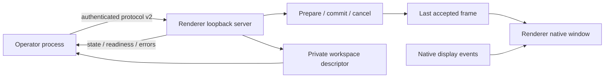

# Phase 2 — Separate renderer process and controlled display recovery

Baseline: 5 November 2026. This is an implementation plan with acceptance gates. Code presence, successful compilation and physical multi-display verification are distinct claims. Results belong in `docs/PHASE2_VERIFICATION.md` and `docs/QA.md` after the relevant check actually runs.

## Resulting operator workflow

The operator starts the normal desktop app and prepares the service. Opening presentation output either reconnects to an already running renderer from this workspace or launches a renderer process from the same executable with the `--cantivra-output` role. A new renderer starts black. Only an explicit Go Live or Restore action exposes content.

The renderer owns its native window, display profile, last accepted snapshot and local IPC server. An operator crash or abrupt control-connection loss leaves that process and its accepted output alive. Normal Quit first saves the draft and explicitly closes the renderer; a failed close keeps the operator available. Reopening the operator reconnects, retrieves authoritative output state and shows it in the live monitor; it does not replace it with a recovered draft. Deliberately closing presentation output is distinct from closing the operator.

If the congregation display disappears, the renderer immediately hides its window and retains the accepted snapshot. Replugging makes the display available without revealing hidden content. The operator reviews status and explicitly rearms the output. No missing-display fallback can place congregation content over the operator desktop.

## Process and IPC design



The loopback server binds explicitly to a local interface on a dynamically allocated port. It is not an optional network receiver service and must not bind to all network interfaces. The renderer writes a workspace-specific descriptor in application support storage containing the endpoint, process/session identity, protocol version and an unpredictable token. Use restrictive permissions where supported. The descriptor is operational state, not library data or a backup ingredient, and should never be checked into source control or included in logs.

The operator first sends `hello` with the expected session and token. The application layer rejects every other method before successful authentication. Failed/stale descriptor discovery must not overwrite or kill an unrelated process: validate identity, refresh state and launch a new renderer only when it is safe to establish that no usable renderer exists. Reconnection uses the renderer's authoritative snapshot/revision, including black/frozen/background state, rather than assuming an old operator view is current.

`lib/platform/local_rpc.dart` is the transport building block. It uses protocol-v2 newline-delimited UTF-8 JSON with a bounded byte accumulator before decoding, a 1 MiB default message limit, bounded pending requests, bounded concurrent incoming handlers and a bounded flush queue. Handlers can run concurrently so an emergency request does not wait behind ordinary preparation. Request timeouts remove pending entries; disconnect fails outstanding calls; malformed frames close the connection. Unknown/late valid response IDs are ignored. The application owns authentication, service-session state and presentation revisions.

RPC envelope shapes:

```json
{"protocol":2,"type":"request","id":1,"method":"hello","args":{"session":"...","token":"..."}}
{"protocol":2,"type":"response","id":1,"result":{"authenticated":true}}
{"protocol":2,"type":"response","id":2,"error":{"code":"not_authenticated","message":"Authenticate first."}}
{"protocol":2,"type":"event","name":"outputState","payload":{"revision":42}}
```

Tokens above are illustrative, not credentials. The transport carries no shared Dart object references and has no SQLite dependency.

## Safe publication and emergency ordering

Each renderer session has one monotonic revision space. A reconnect must reconcile it before issuing another presentation command. A slide replacement follows explicit stages:

1. `prepare`: validate complete text/theme/layout and any assets without touching the accepted frame.
2. `commit`: accept only the intended prepared candidate and revision; swap the value atomically and acknowledge after the rendering frame is ready.
3. `cancel`: discard a superseded preparation without changing accepted content.

The renderer keeps the last accepted frame when validation, preparation, transport or optional work fails. Emergency black has a newer revision, cancels/supersedes older work and cannot be undone by a delayed commit or ACK. A stage acknowledgement is not a hardware/camera measurement; visible-HDMI acceptance remains a physical test.

Freeze, clear text, background visibility and restore remain explicit output state. Operator editing, search, service reordering and theme changes never invoke commit. New renderer processes start black, while reconnecting to a surviving renderer preserves what it already accepted.

## Display profiles

Persist a versioned profile with a name, explicit display identity, safe inset, uniform output scaling and deliberate rehearsal choice. The current canvas remains fixed at 16:9; arbitrary aspect ratios and hardware fingerprint matching remain later work. Preserve the canonical 1920 × 1080 canvas, measure text against its safe area and letterbox uniformly. The native layer owns monitor coordinates and DPI conversion; the application passes identity/profile values instead of guessing cross-platform bounds.

Monitor disappearance must hide the renderer from the renderer process itself; it cannot depend on an operator timer that stops when the operator crashes. Reconnection produces a clear disarmed/available state. Profile changes prepare a candidate independently of live content, and scaling never introduces uncontrolled stretching or cropping.

## Implementation milestones and verification gates

| Work | Required evidence |
| --- | --- |
| Bounded local RPC | Real-loopback tests for fragmented/coalesced UTF-8 frames, exact envelope validation, oversize input, pending/incoming limits, timeouts, late responses, disconnect cleanup, error propagation and emergency concurrency. |
| Authentication/discovery | Wrong token/session and pre-hello calls rejected; private descriptor behavior and stale endpoint recovery tested; no secrets in logs/backups. |
| Renderer process lifecycle | Same-executable launch starts black; operator exit/forced termination leaves renderer alive; reconnect reads authoritative state; explicit output close shuts renderer down safely. |
| Staged output | Preparation rejection preserves last good frame; stale commit/cancel and delayed ACK cannot overtake emergency black; draft/live isolation continues passing. |
| Display recovery | Native removal hides window even without operator; reconnect stays disarmed until explicit rearm; profile persistence and DPI geometry exercised. |
| Native distribution | Build both runners; record debug/ad-hoc macOS verification separately from release signing and notarization. |

## Platform and production limitations

The available development host is macOS. A successful ad-hoc/debug app build and local native smoke test can verify launch, separate processes, local transport and snapshot behavior there. They do not establish signed distribution, clean-system installation, Windows runtime behavior, TV overscan, actual HDMI disconnection, mixed-DPI hardware behavior or eight-hour reliability.

Windows CI can compile and run automated tests using appropriate hosted tooling. Optional signed Windows packaging requires the owner's signing credentials/certificate and is not claimed available in this workspace. macOS notarization/distribution signing likewise needs the intended release identity and entitlement review. Essential runtime functionality remains offline and does not depend on signing-service availability during a church service.

Before calling this phase hardware verified, run the existing Windows/macOS physical matrix in `docs/QA.md`, including 1080p, 4K, primary/secondary arrangements, DPI changes, HDMI unplug/replug, sleep/wake, rapid switching and operator-process termination. Record actual hardware, OS, app build and every observed failure. Network receivers, advanced imports and media playback remain later independent milestones.

## Transport implementation evidence

On 5 November 2026, `lib/platform/local_rpc.dart` and its real-loopback test suite passed formatting and scoped static analysis. `flutter test test/platform/local_rpc_test.dart --reporter expanded` passed 36 tests on the available macOS host. This covers the transport gates above, including bounded write bursts and unknown/late response handling. Authentication, renderer-process survival, stage/revision policy and native display behavior are application-level gates and are not established by those transport tests.

## Current implementation evidence

The core process, authentication, prepare/commit, profiles and native lifecycle code is implemented. The original 0.2 suite passed 158 tests. A release-mode native run forced the operator process to terminate, confirmed that the renderer remained visible with identical frozen content, then connected a new operator and exercised blackout/restore. The 0.3 closure review adds malformed-argument rejection, rendering-schema compatibility and hidden-window paint readiness; the combined suite now passes 210 tests and a 1,000-transition native workload. See [PHASE2_VERIFICATION.md](PHASE2_VERIFICATION.md) and [PHASE3_VERIFICATION.md](PHASE3_VERIFICATION.md) for build details and open hardware/Windows gates.
